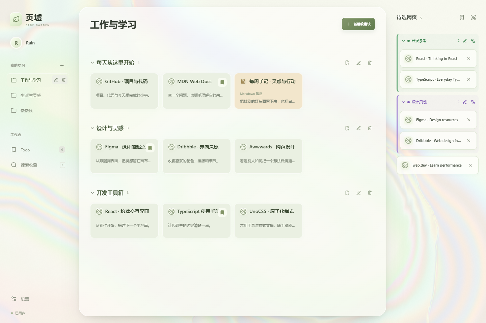
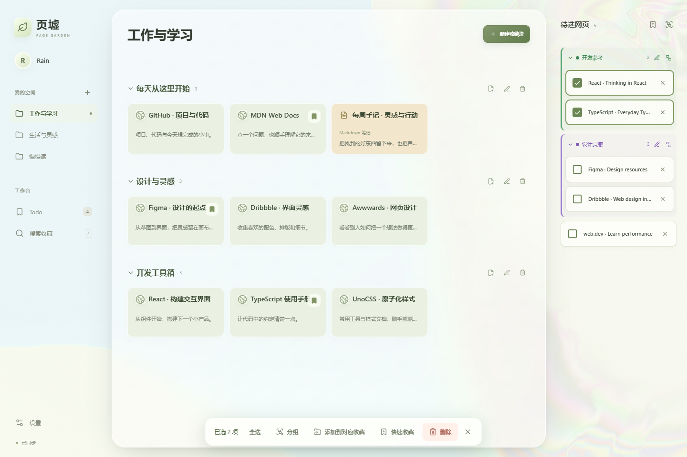
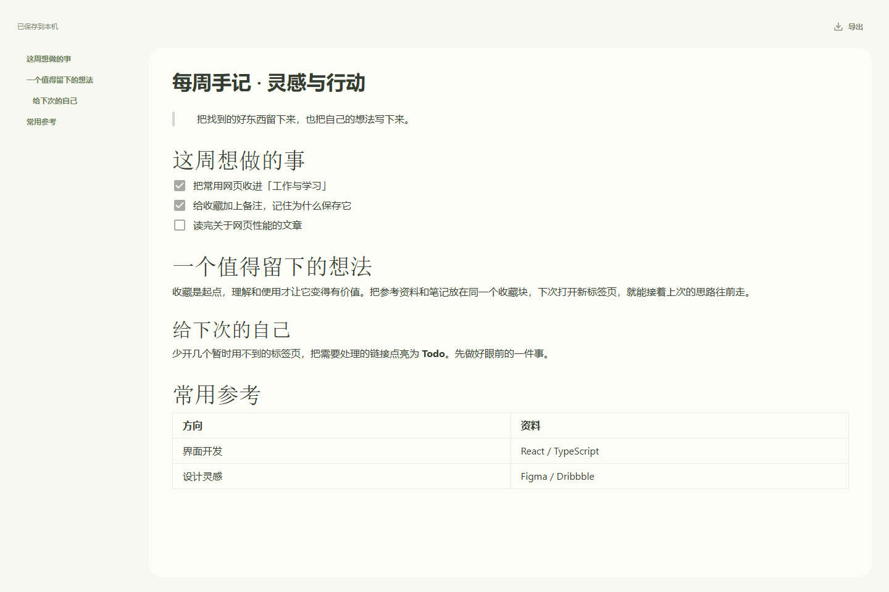
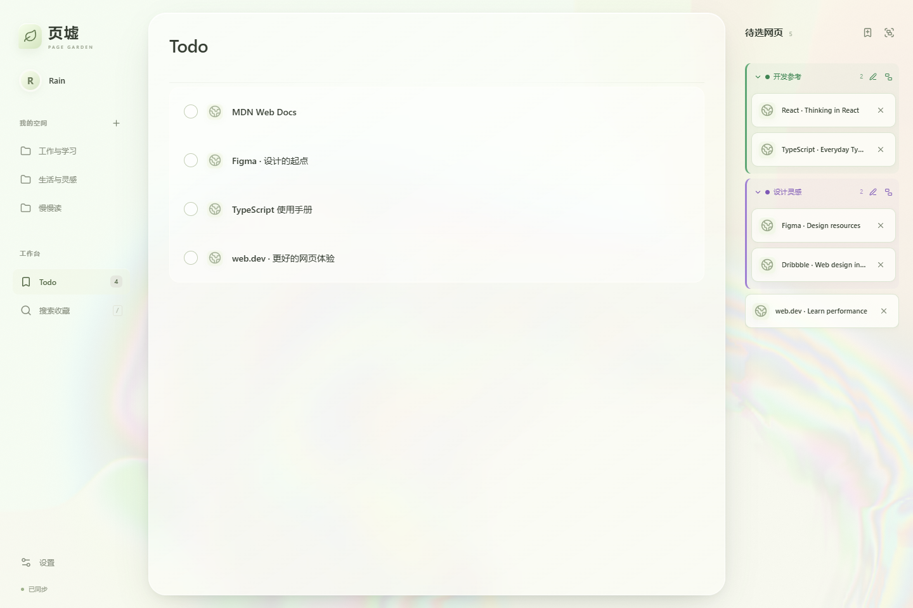

<p align="center">
  
</p>

<h1 align="center">页墟 · Page Garden</h1>

<p align="center">把打开的网页收好，把想法留下。<br>用空间、收藏块和 Markdown 笔记，整理你的 Chrome 新标签页。</p>

<p align="center">Google Chrome · 本地安装 · 夸克网盘同步</p>



## 让收藏成为下次打开的起点

浏览时先打开，忙完再收拾。页墟把当前窗口的网页放进右侧待选区域，拖一下就能收进收藏块；按项目、学习或生活建立空间，让链接、笔记和接下来要读的内容各有位置。奶白与鼠尾草绿的界面，搭配玻璃面板和可关闭的流体背景动画。

- **按空间整理**：一个空间容纳多个收藏块，链接和笔记可以混排、拖动排序、跨块移动。
- **收起满屏网页**：拖入收藏块、一键收藏或多选快速收藏，保存成功后关闭原标签页。
- **边读边记**：在收藏块中直接创建 Markdown 笔记，自动保存，支持排版编辑、大纲与 `.md` 导出；也能打开本地 Markdown 文件和文件夹。
- **让待读浮上来**：点亮链接的书签标记，加入全局 Todo；按自己的节奏排序和完成，收藏仍然保留。
- **随时找回来**：按 `/` 搜索所有空间的标题、网址、备注和笔记正文，再定位回原收藏块。
- **离线也能继续**：内容先保存在本机，联网后同步到夸克网盘，也可继续使用已有的 WebDAV 数据源。

## 看看它怎么用

### 把标签页归组，再一起收好

待选区域与 Chrome 原生标签组同步，支持改名、换色、折叠和整组拖动。多选后可以分组、选择目标收藏块，或快速收进新收藏块。



### 让笔记留在资料旁边

收藏块里的笔记会在独立标签页打开，标题和正文实时保存。用标题、清单和表格整理想法，通过大纲跳转，或导出 Markdown 继续使用。



### 给想读的链接留一个位置

各个空间中标记过的链接汇集到全局 Todo。拖动调整顺序，点击标题打开网页，完成后取消标记。



以上为实际扩展界面，收藏内容均为示例。

## 安装

当前仅支持 **Google Chrome**，尚未上架 Chrome 应用商店。可从源码构建后本地安装，需要 Node.js 与 pnpm，pnpm 版本见 [package.json](package.json)。

```powershell
git clone https://github.com/rain0002009/new-page.git
cd new-page
pnpm install --frozen-lockfile
pnpm build:chrome
```

打开 `chrome://extensions`，开启右上角的「开发者模式」，选择「加载已解压的扩展程序」，加载项目中的 `dist/chrome` 文件夹，再打开一个新标签页。

## 开始使用

1. **连接收藏库**：点击「扫码登录夸克」，用夸克 App 扫码确认；已有 WebDAV 数据源也可选择「WebDAV」连接。
2. **建立你的空间**：按用途创建空间和收藏块，把右侧待选网页拖进来，或点击「一键收藏」收起当前窗口的网页。
3. **继续阅读与记录**：在收藏块中创建笔记，把待读链接加入 Todo，用 `/` 搜索收藏。

## 数据与备份

收藏和笔记先保存在当前设备，再同步到你连接的夸克网盘或 WebDAV。夸克中的「页墟收藏」保存当前收藏数据和笔记的 Markdown 副本；在网盘手动修改 Markdown 不会回写扩展。登录 Cookie 与 WebDAV 密码仅存于本机；配置的 s.ee API Key 会随收藏库同步，并包含在导出备份中。

设置中可导入、导出 JSON 备份，恢复 30 天内删除的链接、收藏块和空间。**单独删除一篇笔记会立即永久生效**。云端不保留同步历史，卸载扩展会清除本机数据，建议定期导出备份。同步冲突、图床图片清理与权限说明见[完整指南](docs/guide.md)。

## 开发与反馈

React + TypeScript · Extension.js · UnoCSS · Milkdown

```powershell
pnpm dev:chrome     # 启动开发环境
pnpm typecheck     # 类型检查
pnpm test          # 构建并运行 Chrome 自动化测试
```

[使用与开发指南](docs/guide.md) · [功能规格](docs/specs/new-tab-bookmarks.md) · [领域与架构](CONTEXT.md) · [问题与建议](https://github.com/rain0002009/new-page/issues)

Chrome 应用商店的文案、隐私政策、权限说明、审核步骤与打包方法见[发布材料](docs/chrome-web-store/README.md)。
